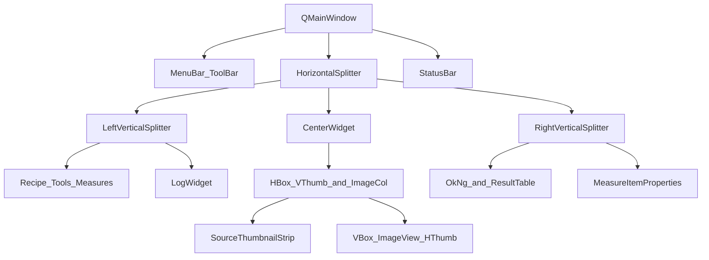
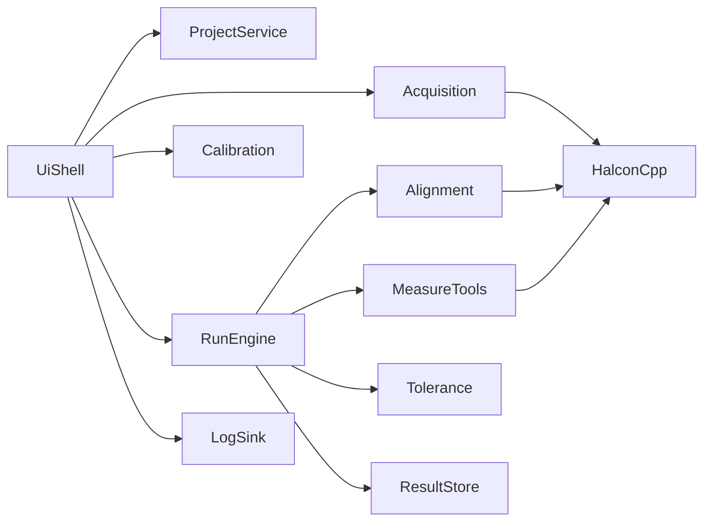
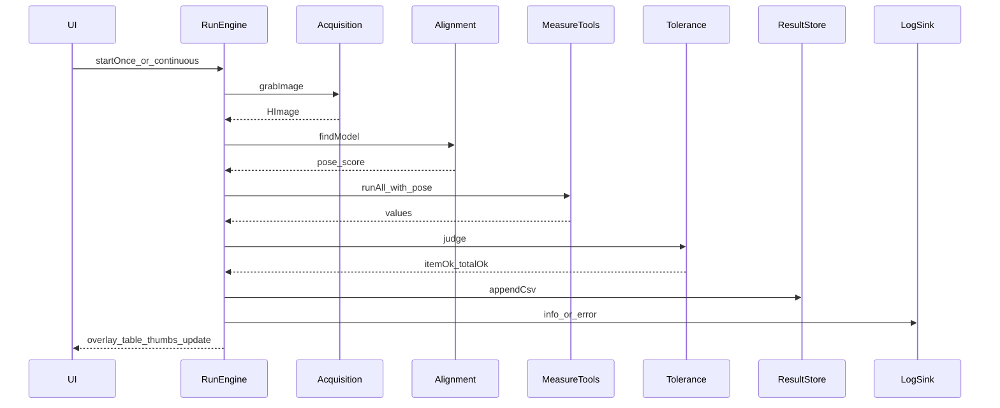

# MeasureExpert 实施文档

> 版本：V1.5  
> 状态：已确认并按本文编码  
> 工程：仓库根目录（相对路径，不含本机盘符）  
> 运行目录：与源码同级的 `../MeasureExpert_runtime/`（Debug/Release 同目录；可用 `-DME_RUNTIME_DIR` 覆盖）  
> 工具清单与能力对照：见 [`docs/工具地图.md`](工具地图.md)

参考（本机可选，不作为构建依赖路径）：

- GUI 壳布局：烛照 ZhuZhao 的 MainWindow / 缩略图 / 日志 / 工作线程
- HALCON 显示：官方例程 `examples/cpp/qt/Matching` 中的 `QHalconWindow`（若安装包含 C++ 例程）
- 定位+测量：hdevelop 中 `pm_measure_board`、卡尺 `gen_measure_rectangle2` 等

---

## 1. 文档目的与范围

### 1.1 目的

指导用 **Qt Widgets + HALCON** 开发桌面端「工业通用测量专家」：配方驱动完成采图、定位、几何测量、公差判定与结果落盘。  
产品形态为 **工具箱 + 配方流水线**（非纯例程演示器，亦非仅 board 固定管线）。

### 1.2 范围内（MVP → V1.5）

- 单工位、单图像源（本地图片/文件夹优先，相机接口预留）
- 形状匹配定位 + ROI/卡尺跟随
- **V1.5 工具箱（范围冻结）**：定位、找线、找圆、卡尺宽度/直径、点线距/交点/夹角/点距派生
- 公差判定与 OK/NG 显示
- 工程/配方 JSON、CSV 结果、UI/文件日志
- 编辑模式 / 运行模式
- 统一 `ITool` / 几何结果；步骤可引用前序结果

### 1.3 范围外（V2+）

- 标定板/世界坐标、**完整 2D Metrology**、表达式测量项
- 多相机、TCP/PLC 实装、权限、SPC、深度学习
- 烛照式 OpenCV 光度立体算法
- 模糊测量、多目标定位

---

## 2. 产品定位与设计原则

| 原则 | 说明 |
|------|------|
| 工具箱 + 配方 | 工具可单独试跑；配方将工具排成步骤并跟随/判公差 |
| 配方驱动 | 所有测量逻辑落在配方，不写死在界面 |
| 先定位再测量 | 卡尺相对模板坐标存储，运行时仿射跟随 |
| 算法与界面分离 | HALCON / 测量逻辑放 `src/Alg/`，界面放 `src/UI/`，UI 只发命令与收结果 |
| 壳层学烛照，业务自建 | Splitter、缩略图、日志、工作线程学烛照；配方/公差/工具自建 |
| 主图用 Qt 图像窗口 | 烛照式 `CustomImageView`（QGraphicsView），便于 ROI/自定义叠加；OpenCV/HALCON 经 `ImageConvert` 互通 |
| 路径可移植 | 仓库内只用相对路径；第三方库靠环境变量 / CMake 缓存变量 |

---

## 3. 对烛照的借鉴清单

### 3.1 采用

| 做法 | 本项目落地 |
|------|------------|
| 嵌套 `QSplitter` 纯代码布局 | 主窗 `initWidget` |
| 左上配置 / 左下日志 | 左栏：配方+工具+测量项 / 日志 |
| 源图竖向缩略图 | `ThumbnailStrip` |
| 算法 `QThread` | `RunEngine` |
| UI + 按日文件日志 | `LogSink` |
| Fusion + `tr()` 中文 | `main.cpp`，预留 `.ts` |

### 3.2 不采用

- Listener 观察者位标志 → **Qt 信号槽**
- 无菜单/工具栏/状态栏 → **补上**
- 无 OK/NG → **右侧判定栏**
- OpenCV DLL / 四光源面板 → OpenCV 已接入；四光源面板不引入
- `QHalconWindow` 作主图 → **改用烛照 Qt ImageView**（ROI/自定义更灵活）

---

## 4. 界面实施规格

### 4.1 总布局

```text
┌─────────────────────────────────────────────────────────────────────┐
│ 菜单：文件 | 采集 | 标定 | 运行 | 工具 | 帮助                              │
│ 工具栏：新建打开保存 | 加载图/上一张下一张 | 单次试跑 | 连续运行 | 停止 | 编辑⇄运行 │
├────────────────┬──────────────────────────────┬─────────────────────┤
│ 左栏(垂直分割)  │ 中栏                         │ 右栏(垂直分割)       │
│                │  ┌────┬───────────────────┐  │                     │
│ 配方与工具     │  │竖缩│  CustomImageView  │  │ 总判定 OK/NG        │
│ 测量项列表     │  │略图│  (Qt/烛照方案)    │  │ 大字+耗时/得分      │
│ 选中项简要参数 │  │    │                   │  │ 测量结果表          │
│ ────────────── │  └────┴───────────────────┘  │ 测量项属性(名义公差) │
│ 运行日志       │  横向缩略图(可选,高~100)       │                     │
├────────────────┴──────────────────────────────┴─────────────────────┤
│ 状态栏：图像源 | 标定(px/mm) | 节拍 | 模式 | 通信(预留)                 │
└─────────────────────────────────────────────────────────────────────┘
```

### 4.2 分割器结构



### 4.3 区域行为矩阵

| 区域 | 编辑模式 | 运行模式 |
|------|----------|----------|
| 左-配方/工具/测量项 | 增删改、画/调 ROI | 可切换配方；工具箱禁用 |
| 左-日志 | 调试信息 | 异常与节拍 |
| 中-竖缩略图 | 选调试图 | 批次/文件夹序列 |
| 中-主图 | 画模板、卡尺、标尺 | 只显示叠加与红绿 |
| 中-横缩略图 | 可选中间过程 | 最近结果快照（可二期） |
| 右-判定与表 | 试跑刷新 | 产线主看区 |
| 右-属性 | 改公差单位 | 只读 |
| 顶栏 | 单次试跑 | 连续运行 |

### 4.4 对话框

1. **采集设置**：文件夹；相机枚举/曝光（预留）
2. **像素当量标定**：已知长度 → mm/pixel
3. **定位模板向导**：ROI → Shape Model → 搜索区与 minScore

### 4.5 交互规则

1. 左栏选中测量项 ↔ 主图高亮对应卡尺
2. 编辑「试跑」可不写 CSV；运行模式写 CSV
3. 匹配失败：总判定 NG，表内写原因，进程不崩
4. 未标定：允许输出像素，状态栏显示「未标定(px)」
5. 关闭/切换工程前提示未保存

---

## 5. 模块设计

### 5.1 模块图



### 5.2 模块职责表

| 模块 | 职责 | 主要类型建议 | MVP |
|------|------|--------------|-----|
| UiShell | 主窗、模式、菜单工具栏 | `MainWindow` | 必做 |
| ThumbnailStrip | 源图竖条 | `ThumbnailStrip` | 必做 |
| LogSink | UI + 按日文件 | `LogWidget` / `LogSink` | 必做 |
| ProjectService | 工程配方读写 | `Project` `Recipe` | 必做 |
| Acquisition | 文件夹取图；相机接口 | `ImageSource` | 必做 |
| Calibration | 像素当量换算 | `PixelCalibration` | 必做 |
| Alignment | 形状匹配 + 位姿 | `AlignmentService` | 必做 |
| MeasureTools | 卡尺工具执行 | `MeasureService` | 必做 |
| Tolerance | 单项/总判定 | 内嵌服务即可 | 必做 |
| RunEngine | 工作线程流水线 | `RunEngine` : `QThread` | 必做 |
| ResultStore | CSV 追加 | `CsvResultStore` | 必做 |
| CommIO | TCP/IO | 空接口类 | 仅预留 |

### 5.3 线程与信号约定

- UI 线程：不调用耗时 HALCON 算子（除快速叠加显示）
- `RunEngine`：`grab → find → measure → judge → csv`，通过信号回传：
  - `imageReady` / `overlayReady`
  - `resultsReady(QList<MeasureResult>)`
  - `judgmentReady(bool ok, QString reason)`
  - `errorOccurred(QString)`
  - `cycleFinished(int elapsedMs)`

---

## 6. 数据模型

### 6.1 逻辑结构

```text
Project
  name, version
  imageSource: { type: Folder|Camera, path/or params }
  calibration: { calibrated: bool, pixelSizeMm: double, unit: "mm"|"px" }
  recipes: Recipe[]

Recipe
  id, name, enabled
  alignment:
    modelFile / inline params
    searchRegion
    minScore
    angleStart, angleExtent  (可选)
  measures: MeasureItem[]

MeasureItem
  id, name
  type: CaliperWidth | CaliperDiameter | PointDistance
  geometry: 相对模板坐标系的卡尺参数
  nominal, upper, lower
  unit, decimals
```

### 6.2 持久化

- 工程文件：`*.mexp.json`（UTF-8 JSON）
- 形状模型：配方目录下 HALCON model 文件（相对工程路径）
- 结果 / 日志：默认写在运行目录下（如 `../MeasureExpert_runtime/results/`、`log/yyyy-MM-dd/log.txt`），由程序按需创建，不纳入源码仓库

### 6.3 坐标约定

- 编辑时在图像上画的几何，转换后存 **相对模板** 坐标
- 运行：`HomMat2D = find_shape_model` 位姿 → `affine_trans_*` 得到当前卡尺再 `measure`
- 与 HALCON 例程 `pm_measure_board` 一致

---

## 7. 运行流水线



### 7.1 单次周期步骤（实现检查表）

1. 取图（失败 → 日志 + NG，结束本周期）
2. 显示原图
3. 形状匹配（失败 → 原因「定位失败」+ NG）
4. 按位姿变换全部测量项几何
5. 执行各卡尺，换算单位（有标定则 mm，否则 px）
6. 公差判定，汇总总判定
7. 叠加绘制（OK 绿 / NG 红）
8. 刷新结果表与 OK/NG 大字
9. 运行模式写 CSV；编辑试跑按开关决定是否写

---

## 8. 目录与工程结构

```text
MeasureExpert/                 # 仓库根（源码）
  CMakeLists.txt
  README.md
  CMakeUserPresets.json.example
  docs/
    实施文档.md
  scripts/
    build_msvc.bat
  src/
    main.cpp
    Core/                      # 工程/配方数据与 JSON（ProjectService）
    UI/                        # 界面（MainWindow 等）
    Alg/                       # 定位/测量/判定/RunEngine
  3rdParty/Halcon/             # include + lib

MeasureExpert_runtime/         # 与源码同级，不进仓库
  MeasureExpert.exe            # Release
  MeasureExpertD.exe           # Debug
  .cmake/Debug|Release/        # CMake 中间树
  results/  logs/              # 运行期按需生成
```

### 8.1 路径约定（开源 / 可移植）

| 用途 | 约定 |
|------|------|
| 源码、文档、脚本 | 相对仓库根 |
| 可执行文件默认输出 | `${CMAKE_SOURCE_DIR}/../MeasureExpert_runtime` |
| 覆盖输出目录 | `-DME_RUNTIME_DIR=<path>` |
| CMake 中间目录 | `../MeasureExpert_runtime/.cmake/Debug` 与 `Release` |
| HALCON 头/库 | 仓库 `3rdParty/Halcon` |
| OpenCV | 与烛照相同：`find_package(OpenCV)`；优先 `3rdParty/OpenCV`（见 `docs/第三方依赖.md`） |
| 本机 Qt Creator 配置 | `.qtcreator/`（gitignore） |
| 本机 CMake 预设 | 复制 `CMakeUserPresets.json.example` → `CMakeUserPresets.json` |

构建：CMake + Qt6 Widgets + HALCON C++（`halconcpp`）。

---

## 9. 开发分期与任务拆分

### 阶段 1：主壳（约可独立验收「能开窗看图」）

- [x] CMake 工程可编译链接 HALCON + Qt + OpenCV
- [x] `MainWindow`：`QSplitter` 三栏骨架 + 菜单/工具栏/状态栏
- [x] 集成烛照式 `CustomImageView`（缩放/拖拽/双击复位；加载图试显示）
- [x] `LogWidget` + `LogSink`：UI 输出调试信息；文件落在 exe 同级 `log/yyyy-MM-dd/log.txt`
- [x] `ThumbnailStrip` 竖条可加载文件夹图片并点选显示（上一张/下一张）
- [x] （已取消）结果横条缩略图——结果改由主图叠加与右侧判定区展示

**验收**：打开软件 → 选文件夹 → 点缩略图 → 主图显示。

### 阶段 2：工程与配方

- [x] `Project`/`Recipe`/`MeasureItem` 数据结构（`src/Core`）
- [x] JSON 新建/打开/保存（`*.mexp.json`）
- [x] 左栏配方列表、测量项列表（添加/删除）
- [x] 未保存提示（新建/打开/关闭）

**验收**：保存工程再打开，列表一致。

### 阶段 3：测量闭环

- [x] 像素当量标定对话框
- [x] 定位模板创建与 `AlignmentService::find`
- [x] 至少 `CaliperWidth` 一种工具（ROI 跟随；`CaliperDiameter` 同步可用）
- [x] 公差判定 + 右栏 OK/NG + 结果表
- [x] `RunEngine` 单次试跑

**验收**：对示例图单次运行，出数值与 OK/NG。

### 阶段 4：产品化收尾

- [x] 第二种工具（`CaliperDiameter`；添加测量项时可选择）
- [x] 连续运行 + 停止（文件夹序列循环）
- [x] CSV 落盘（运行模式写入 `results/yyyy-MM-dd.csv`）
- [x] 编辑/运行模式切换锁控件
- [x] `IImageSource` / `ICommIO` 空接口预留
- [x] README 运行说明完善

**验收**：满足第 10 节 MVP 清单全部勾选。

### 阶段 5：V1.5 工具箱（本阶段）

- [x] 《工具地图》+ 本文 V1.5 范围冻结
- [x] `ITool` + 统一几何结果；Alignment / CaliperWidth 迁入工具调度
- [x] 找线（`measure_pos` + 直线拟合）+ 主图叠加
- [x] 找圆（圆弧卡尺 + 圆拟合）+ 配方跟随
- [x] 点线距 / 两线交点 / 夹角 / 点距派生 + 公差

**验收**：同图在 HDevelop 与本软件得到同量级结果；派生项可引用前序找线/找圆。

---

## 10. MVP 验收清单

| 编号 | 条目 | 通过标准 |
|------|------|----------|
| M1 | 主壳布局 | 三栏可拖拽，菜单工具栏状态栏齐全 |
| M2 | 离线采图 | 文件夹序列 + 竖缩略图切换 |
| M3 | 工程配方 | JSON 存读，含测量项 |
| M4 | 标定 | 像素当量；未标定可出 px |
| M5 | 定位 | 形状匹配成功/失败均有明确 UI |
| M6 | 测量 | ≥2 种卡尺工具，跟随定位 |
| M7 | 判定 | 单项 + 总 OK/NG，叠加着色 |
| M8 | 线程 | 连续跑 UI 不卡死 |
| M9 | 日志 | UI 可见 + 按日文件 |
| M10 | CSV | 含时间戳、配方名、各项值、判定 |

---

## 11. 技术风险与对策

| 风险 | 对策 |
|------|------|
| HALCON 窗口与 Qt 交互局限 | 主图改用 Qt ImageView；算法结果转 QImage/几何后叠加 |
| 工作线程碰 UI / 窗口句柄 | 仅传 `HImage` 与结果结构；显示回 UI 线程 |
| 卡尺坐标跟错 | 统一「相对模板」存储，单测仿射跟随 |
| 环境变量未配 | README / 本文写明；CMake 失败时清晰报错 |
| 范围膨胀 | 严格按四阶段；V2 项不进 MVP |
| 本机绝对路径泄漏 | 禁止写入 `CMakeLists.txt` / 脚本；本机配置进 gitignore |

---

## 12. 环境与构建（他人克隆后）

### 12.1 依赖

1. Qt 6.5+（MSVC 套件，与 HALCON 位数一致，一般为 64-bit）
2. Visual Studio（含 C++ 桌面开发）或等价 MSVC 工具链
3. CMake ≥ 3.19
4. HALCON（已安装并授权）

### 12.2 环境变量

| 变量 | 示例含义 |
|------|----------|
| `CMAKE_PREFIX_PATH` 或 `QTDIR` | Qt MSVC kit 前缀（含 `lib/cmake/Qt6`） |
| `PATH` | 需含本机 HALCON `bin\<arch>`（运行 DLL）与 Qt `bin` |

链接头文件/库使用仓库内 `3rdParty/Halcon`，无需再设 `HALCONROOT` 才能配置工程。

可选：`CMAKE`、`VCVARS`、`JOM` / `ninja`（见 `scripts/build_msvc.bat`）。

### 12.3 Qt Creator

1. 打开仓库根目录 `CMakeLists.txt`
2. Kit：本机 **Desktop Qt … MSVC … 64bit**（勿用不含编译器的孤立 Preset Kit）
3. 构建目录建议：
   - Debug：`../MeasureExpert_runtime/.cmake/Debug` → `MeasureExpertD.exe`
   - Release：`../MeasureExpert_runtime/.cmake/Release` → `MeasureExpert.exe`
4. 运行工作目录：`../MeasureExpert_runtime`
5. 配置 → 构建 → 运行

### 12.4 命令行

```bat
scripts\build_msvc.bat
```

---

## 13. 确认与变更

- 本文为实施依据；编码前确认第 4 章布局与第 9～10 章范围。
- 变更需求时先改本文对应章节，再改代码，避免口头漂移。
- 路径、工具链相关变更同步更新 `README.md` 与 `CMakeLists.txt` 注释。
